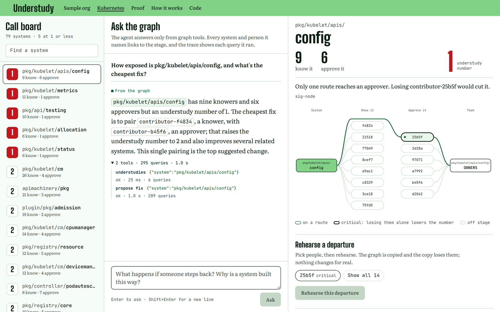
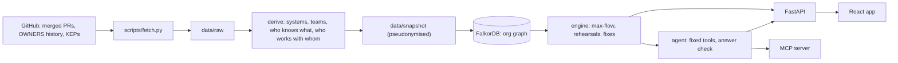

# Understudy

Understudy measures how many people a team can lose before nobody who approves changes to a system can reach anyone who knows its code. It models Kubernetes as a graph in FalkorDB, computes that number for every part of the codebase with max-flow, lets you rehearse a departure on a copy of the graph, and includes an agent that answers questions only from graph queries and shows every query it ran.

**Live app:** https://understudy-u2qk.onrender.com

Built for Graph Hacks: Context for AI Agents (WeMakeDevs x FalkorDB), October 2026. Tracks: Company Brain, and Agents That Act on Connected Data.



## Contents

- [Why](#why)
- [Features](#features)
- [Quick start](#quick-start)
- [A two-minute tour](#a-two-minute-tour)
- [How it works](#how-it-works)
- [Graph model](#graph-model)
- [Queries and algorithms](#queries-and-algorithms)
- [The agent](#the-agent)
- [Using it from Claude Code (MCP)](#using-it-from-claude-code-mcp)
- [Does the number predict anything?](#does-the-number-predict-anything)
- [FalkorDB issues found](#falkordb-issues-found)
- [Development](#development)
- [Project layout](#project-layout)
- [Limitations](#limitations)
- [Privacy](#privacy)
- [License](#license)
- [AI disclosure](#ai-disclosure)

## Why

Counting the people who know a system makes it look safe. `pkg/kubelet/apis/config` in Kubernetes has 9 people who worked on it in the last 18 months and 6 people who can approve changes to it. By headcount it is well covered.

It isn't. Only one of the six approvers knows the code. Three of the others work with nobody who knows it except that same person, and two work with nobody who knows it at all. Every working route from "knows the code" to "can approve the change" passes through one person.

Understudy counts those routes. A route is either one person (an approver who knows the code) or two (someone who knows it, plus an approver who works with them), and two routes count separately only if they share nobody. The number of separate routes is the **understudy number**. By Menger's theorem it is also the fewest people who would have to leave before no route remains. For `pkg/kubelet/apis/config` it is 1.

## Features

- **Call board.** All 79 Kubernetes systems, ranked by understudy number, with how many people know and approve each.
- **Stage.** For one system: who knows it, who approves it, the routes between them, and who is critical (losing them alone lowers the number).
- **Rehearsals.** Take people off stage on a copy of the graph made with `GRAPH.COPY` and see every number that drops. The real graph never changes. A full Kubernetes rehearsal takes about 0.1 seconds on a laptop.
- **Fixes.** Candidate fixes (pair someone who knows the code with an approver, or make them an approver) are each applied to their own copy of the graph, and only the ones that raise the number are offered.
- **Personal copies.** Departures and fixes can be applied for real to a private copy of the graph that lasts two hours.
- **An agent that shows its work.** It answers questions about the graph using nine fixed tools, never writes Cypher, checks its answer against what the tools returned, and shows each tool call and query.
- **MCP server.** The same tools are available in Claude Code, Cursor or any MCP client.
- **No setup data needed.** The graph ships as a small snapshot of pseudonymised data, so the app runs with no GitHub token and no API keys.

## Quick start

Requires Docker.

```bash
git clone https://github.com/BalajiReddy1/understudy
cd understudy
docker compose up --build
```

Open http://localhost:8000. The first build takes a few minutes; after that the app is ready a few seconds after it starts.

The agent works without a key by running the matching graph tools and showing their results. To let it use a language model, get a free key from [Groq](https://console.groq.com) and put it in a `.env` file next to `docker-compose.yml`:

```bash
GROQ_API_KEY=your-key
```

## A two-minute tour

On the [live app](https://understudy-u2qk.onrender.com) or a local copy:

1. On the home page, the sample org has seven people. Select **dev** and press **Rehearse this departure**. Billing and ledger drop to 0; auth only drops to 2.
2. Open **Kubernetes**. `pkg/kubelet/apis/config` is at the top of the call board: 9 people know it, 6 approve, understudy number 1.
3. Ask: *How exposed is pkg/kubelet/apis/config, and what's the cheapest fix?* Expand the trace under the answer to see the tool calls and Cypher queries.
4. Ask: *How safe is test/e2e/node?* That directory is not modelled, and the agent says so instead of guessing.
5. Open **Proof** for the backtest, and **How it works** for the graph model and queries.

## How it works



**Data.** Every merged pull request in kubernetes/kubernetes from January 2024 to October 14, 2026 (9,187 PRs, with files, reviews and comments), every version of every OWNERS file as it landed on master, and the KEPs in kubernetes/enhancements. GitHub handles are replaced with salted pseudonyms before anything is written to the graph, and bots are removed.

**Runtime.** A single Docker container runs FalkorDB and the app. The graph is loaded from the snapshot while the image is built and saved into it, so a container starts by reading the saved data rather than recomputing it.

## Graph model

| Node | Count | Description |
|---|---|---|
| `Person` | 364 | Someone active in the last 18 months, as a pseudonym |
| `System` | 79 | A directory with its own OWNERS file under `pkg/`, `cmd/`, `plugin/` or `staging/`, with at least 20 PRs in the window. Smaller directories fold into their parent |
| `Team` | 61 | The approvers listed in a system's nearest OWNERS file, aliases expanded. If everyone listed has gone quiet, approval falls to the next file up |
| `Decision` | 259 | A KEP that merged PRs in a system reference |
| `Port` | 510 | One half of a person in the flow layer (see below) |

| Relationship | Count | Description |
|---|---|---|
| `(:Person)-[:KNOWS {score}]->(:System)` | 1,417 | Authoring a PR scores 1 and reviewing or commenting 0.5, halving every six months. Scores below 1 are dropped |
| `(:Person)-[:COLLABORATES]->(:Person)` | 2,540 | Two people who have been on each other's PRs, one as author and the other reviewing or commenting, at least twice in the last year. Stored in both directions |
| `(:Person)-[:MEMBER_OF]->(:Team)` | 320 | An approver with at least 3 PRs in the last 18 months |
| `(:Team)-[:DEPENDS_ON]->(:System)` | 79 | The team approves changes to the system |
| `(:Decision)-[:SHAPED {prs}]->(:System)` | 1,602 | A KEP, and how many PRs link it to the system |
| `FLOW_n` | 3,756 across 79 types | The flow layer, with one relationship type per system |
| `CARRIES`, `CRITICAL` | 353, 318 | Cached results: who is on a route, and whose departure alone lowers the number |

### The flow layer

Max-flow needs capacities on edges, but the constraint here is on people: nobody can carry more than one route. So each person on a route is split into an in-port and an out-port joined by a `gate` edge with capacity 1. For each system:

- `knows` edges run from the system to the in-port of each person who knows it.
- `channel` edges run from a knower's out-port to the in-port of an approver they collaborate with, but only to approvers who do not know the system themselves (those already form a route on their own).
- `member` edges run from an approver's out-port to their team.

```
billing --knows--> [ana: in -> out] --channel--> [dev: in -> out] --member--> payments
```

Max-flow from the system to its teams over these edges is the number of routes that share nobody. Each system gets its own relationship type (`FLOW_1`, `FLOW_2`, ...) because the edges depend on who knows that system, and FalkorDB's `algo.maxFlow` follows one relationship type per call.

## Queries and algorithms

The agent never writes Cypher; its tools are built on fixed queries. Six of them follow, exactly as they appear in the code.

**Building the gates for a system's knowers** ([derive/flow.py](backend/understudy/derive/flow.py)). `{T}` is the system's own `FLOW_n` type.

```cypher
MATCH (s:System {name: $system})<-[k:KNOWS]-(p:Person)
WHERE p.left_at IS NULL AND k.score >= $min_score
WITH s, p.handle AS h
MERGE (i:Port {person: h, side: 'in'})
MERGE (o:Port {person: h, side: 'out'})
MERGE (i)-[g:{T} {kind: 'gate'}]->(o) SET g.cap = 1
MERGE (s)-[e:{T} {kind: 'knows'}]->(i) SET e.cap = 1
```

**Computing the understudy number** ([engine/understudy.py](backend/understudy/engine/understudy.py)). Max-flow from the system to every team that approves it, returning the edges that carry flow so the routes can be drawn.

```cypher
MATCH (s:System {name: $system})<-[:DEPENDS_ON]-(t:Team)
WITH s, collect(t) AS teams
CALL algo.maxFlow({sourceNodes: [s], targetNodes: teams,
                   relationshipTypes: [s.flow], capacityProperty: 'cap'})
YIELD maxFlow, edges, edgeFlows
RETURN maxFlow, id(s), [t IN teams | id(t)],
       [i IN range(0, size(edges) - 1) WHERE edgeFlows[i] > 0 |
        [id(startNode(edges[i])), id(endNode(edges[i])), edges[i].kind,
         startNode(edges[i]).person]] AS used
```

**Taking people off stage** ([engine/understudy.py](backend/understudy/engine/understudy.py)). Runs on a copy made with `GRAPH.COPY`. Deleting a person's ports removes their gate, which removes every route through them.

```cypher
MATCH (p:Person) WHERE p.handle IN $h SET p.left_at = $when
WITH collect(p.handle) AS hs
MATCH (port:Port) WHERE port.person IN hs DETACH DELETE port
```

**The call board** ([engine/stage.py](backend/understudy/engine/stage.py)).

```cypher
MATCH (s:System)<-[:DEPENDS_ON]-(t:Team)
OPTIONAL MATCH (t)<-[:MEMBER_OF]-(a:Person) WHERE a.left_at IS NULL
WITH s, collect(DISTINCT t.name) AS teams, count(DISTINCT a) AS approvers
OPTIONAL MATCH (s)<-[:KNOWS]-(k:Person) WHERE k.left_at IS NULL
WITH s, teams, approvers, count(DISTINCT k) AS knowers
OPTIONAL MATCH (s)<-[:CRITICAL]-(c:Person)
WITH s, teams, approvers, knowers, count(DISTINCT c) AS critical
RETURN s.name, s.understudy, knowers, approvers, critical, teams,
       s.sigs, s.emeritus_approvers, s.inactive_owners
```

**Trying a pairing as a fix** ([engine/fixes.py](backend/understudy/engine/fixes.py)). Runs on its own copy; the pairing is offered only if the number goes up there.

```cypher
MATCH (a:Person {handle: $a}), (b:Person {handle: $b})
MERGE (a)-[:COLLABORATES]->(b) MERGE (b)-[:COLLABORATES]->(a)
```

**The decisions behind a system** ([agent/tools.py](backend/understudy/agent/tools.py)), used by the agent's `why` tool.

```cypher
MATCH (d:Decision)-[r:SHAPED]->(:System {name: $s})
RETURN d.number, d.title, d.stage, d.status, d.url, d.approvers,
       d.approvers_total, r.prs
ORDER BY r.prs DESC, d.number LIMIT 5
```

Around these queries:

- **Routes.** The edges that carry flow are split into separate paths by walking from the system, which also ignores any separate loop the engine includes in its result ([engine/understudy.py](backend/understudy/engine/understudy.py)).
- **Incremental rehearsals.** A person on no route can leave without changing any number, so a rehearsal recomputes max-flow only for the systems the departing people `CARRIES` ([engine/rehearse.py](backend/understudy/engine/rehearse.py)).
- **Critical people.** Not everyone on a route is critical, because someone else may be able to take their place. Each person on a route has their gate removed on a scratch copy and max-flow is run again, spread across several copies in parallel ([engine/critical.py](backend/understudy/engine/critical.py)).
- **Verification.** The test suite checks every number against networkx and a brute-force search, on random graphs and on the sample org, against both FalkorDB 6.0.2 and 4.22.

## The agent

The agent is a small tool loop over Groq's free tier, using `gpt-oss-120b` with `gpt-oss-20b` as a fallback. Its nine tools: find a system, describe how exposed a system is, rehearse a departure, take people off stage in your own copy, suggest a fix, apply a fix, find who can review, explain which decisions shaped a system, and recall what earlier sessions found.

- **Names are checked first.** Every system and person passed to a tool is resolved against the graph before the tool runs. Real GitHub handles are refused.
- **Four kinds of answer:** from the graph, from an earlier session, not in the graph, or an unrecognised name.
- **Answers are checked before they are shown.** Every system, person, KEP and number in an answer must have come from a tool, and sweeping claims such as "nobody" must appear in a tool's own result. If the check fails, the answer is replaced by the tools' own sentences with a note explaining why.
- **Memory is part of the graph.** Findings are stored, with dates, as nodes in a small graph per visitor and read back in later sessions.
- **It works without a model.** With no key, a keyword router runs the matching tools.
- **Rate limited.** Six questions per ten minutes per visitor, to share the free model quota.

## Using it from Claude Code (MCP)

The MCP server exposes the same tools over stdio. It needs FalkorDB running locally and loads the snapshot on first use.

```bash
docker compose up -d falkordb
uv sync
claude mcp add understudy -- uv --directory /path/to/understudy run python -m understudy.mcp_server
```

Every tool returns a status, a one-sentence summary, the underlying data, and the Cypher queries it ran with their timings. Tools that change anything only touch the server's own copy of the graph. `--http` serves the read-only tools over HTTP instead.

## Does the number predict anything?

The understudy number was tested against real departures before being trusted. The result so far is inconclusive, and it is published as it came out. The method was fixed before the first run. Full details, with a chart and every data point, are on the **Proof** page in the app; the raw result is [data/proof.json](data/proof.json) and the code is [backtest.py](backend/understudy/backtest.py).

**Method.** For every departure in the OWNERS history (a move to emeritus, or removal from every alias), the graph is rebuilt as it stood on the person's last day of activity, and their departure is rehearsed in FalkorDB. The outcome is the median time to the first review or comment on PRs touching each system they knew or approved, in the 90 days after against the 90 days before, divided by the same ratio for the whole project.

**Result.**

- Of 39 departures, 7 could be measured, covering 23 systems. Most people had stopped contributing long before the OWNERS change, some stayed active elsewhere, and the newest are too recent to measure.
- Spearman's ρ between the understudy number and the slowdown is -0.24, in the predicted direction, but the 95% interval is -0.60 to 0.80. A plain headcount gives -0.04.
- None of these departures left a measurable system at 1 or below, so the case the number is designed for did not occur in the data.

A longer history (Kubernetes goes back to 2014) would give enough departures to settle it.

## FalkorDB issues found

Testing every result against networkx on both FalkorDB 6.0.2 and 4.22 surfaced the following. The application works around all of them.

| Issue | Versions | Workaround |
|---|---|---|
| `algo.maxFlow` returns less than the maximum flow when edge capacities differ. With capacities of 1 and 1000 mixed, 8 of 150 random graphs were under-counted; the smallest reproduction has 9 edges | 6.0.2, 4.22 | Every flow edge has capacity 1, which gives the same answer for this model and matched networkx on all 450 test graphs |
| An inline property map that reads a variable from an earlier `MATCH`, such as `MATCH (x:Port {person: a.handle})`, silently matches nothing | 6.0.2 | Pass the value through `WITH` first |
| A specific shape of read-only aggregating query makes the server panic and exit, including through `GRAPH.RO_QUERY` | 6.0.2 | Every query finishes its aggregation in a `WITH`; the agent cannot send arbitrary Cypher |
| `algo.maxFlow` raises an error instead of returning 0 when the relationship type does not exist yet | 6.0.2, 4.22 | The error is read as a flow of 0 |
| Parallel `GRAPH.COPY` calls fail with "could not fork", because 4.22 copies by forking the server | 4.22 | Copies are retried |

## Development

Requirements: Docker, [uv](https://docs.astral.sh/uv/), and Node.js 22 or newer.

```bash
docker compose up -d falkordb                  # FalkorDB 6.0.2 on localhost:6379
uv sync
uv run uvicorn understudy.api:app --port 8000  # loads the snapshot on first start
cd frontend && npm ci && npm run dev           # http://localhost:5173, proxies /api
```

Run the tests against both FalkorDB versions:

```bash
docker run -d --rm --name understudy-fk4 -p 6391:6379 falkordb/falkordb:v4.22.0
cd backend && FALKORDB_TEST_PORTS=6379,6391 uv run pytest
cd frontend && npm test && npm run typecheck
```

### Rebuilding the data

Optional: the snapshot and the backtest result are committed. Rebuilding needs a read-only `GITHUB_TOKEN` and a `PSEUDONYM_SALT` of your own in `.env` (see [.env.example](.env.example)). A different salt produces different pseudonyms.

```bash
uv run python scripts/fetch.py all              # GitHub data into data/raw; safe to stop and resume
uv run python scripts/build_org.py --snapshot   # the org graph, and data/snapshot/org.json.gz
uv run python scripts/backtest.py               # data/proof.json
```

### Deployment

The repository includes a [render.yaml](render.yaml) blueprint for a single Docker web service on Render's free plan. The image is self-contained: FalkorDB listens only inside the container, the graph is baked into the image, and `GROQ_API_KEY` is the only setting. On a 0.1 CPU instance a cold start takes about 30 seconds and the container uses about 80 MB of memory. A scheduled GitHub Actions job ([keep-awake.yml](.github/workflows/keep-awake.yml)) requests the health check every 10 minutes so the free instance doesn't go to sleep.

## Project layout

```
backend/understudy/
  api.py           FastAPI app: call board, stages, rehearsals, fixes, sessions, agent
  mcp_server.py    the agent's tools as an MCP server
  snapshot.py      saving and loading the org graph snapshot
  backtest.py      the backtest behind the Proof page
  agent/           tool loop, tools, answer check, query trace, memory
  derive/          raw GitHub data to the org: systems, teams, KNOWS, KEPs, departures
  engine/          max-flow, rehearsals, critical people, fixes, sessions
  ingest/          GitHub fetchers for PRs, OWNERS history and KEPs
backend/tests/     backend tests, run against FalkorDB 6.0.2 and 4.22
frontend/src/      React app: pages, components, the hand-drawn stage and charts
scripts/           fetch, build_org and backtest command-line scripts
data/              the committed snapshot and backtest result
docker/            container start script and the build-time graph load
```

## Limitations

- Only Kubernetes is modelled, and only what merged pull requests show. Knowledge in documents, chat or meetings is not in the graph, and neither are pull requests that were never merged.
- A route is limited to one or two people by design. With longer chains, routes on the real data passed through ten or more people and a few busy reviewers appeared to carry most systems.
- The backtest has not shown that the number predicts slowdowns. It is based on 7 departures.
- The answer check verifies that every name and number came from a tool, not that the answer relates them correctly.
- The hosted demo runs on 0.1 CPU and the free model has a per-minute token limit, so responses can be slower there than locally.

## Privacy

People appear only as pseudonyms such as `contributor-25b5f`, derived from a salted hash whose salt never leaves the build machine. The committed snapshot contains no GitHub handles, and the test suite checks this. A departure in this data means someone stepped back from an OWNERS file, which is a normal part of open source; nothing here is a judgement of any individual.

## License

[MIT](LICENSE)

## AI disclosure

Understudy is my project. I used Claude Code (Anthropic's coding agent) as my main tool: it wrote most of the code and drafted the tests and these docs. I planned the project with it, chose the problem, the tracks, the graph model and the design, decided what to build and what to cut, and reviewed, ran and checked everything myself before submitting, including all of the FalkorDB work: the graph model, the queries, the max-flow results and the engine bugs. The agent inside the app is a different model: `gpt-oss-120b` on Groq's free tier.
